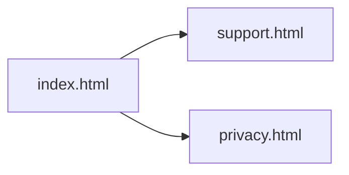

# Invento Site

Static pages for the Invento inventory app: a short landing page, a privacy policy, and a support page.

## Project Overview

`invento-site` is three HTML files with inline CSS. There is no build step, no framework, and no server code. The landing page describes Invento as an inventory app for products, stock, and warehouses, and links to support and the privacy policy.

The support page answers how to create an account, log a stock movement, check stock, read history, and how owners manage products, categories, warehouses, and employees. The privacy policy lists the account and inventory data the app stores.

## Features

- Landing page (`index.html`) with links to support and privacy
- Support page (`support.html`) with contact and FAQs
- Privacy policy (`privacy.html`), last updated August 2026
- Shared layout: centered column, system font, light background

## Tech Stack

- HTML
- CSS in each file
- No JavaScript, package manager, or backend

## Architecture

Each page is self-contained. Navigation is a normal link between files.



Open `index.html` in a browser. Relative links resolve as long as the three files stay in the same directory.

## Local Setup

No install and no environment variables.

```bash
open index.html
```

Or serve the directory:

```bash
python3 -m http.server 8000
```

Then open `http://localhost:8000`.

## Database Design

No database. The pages do not store data.

## API Overview

No API. The contact link is a `mailto:` on the support and privacy pages.

## Security

These files are public marketing and policy pages. Do not put secrets, API keys, or customer data in them. The privacy page states that Invento does not sell personal information and lists the fields the app collects (name, email, and the inventory records a business creates).

## Design Decisions

- One file per page, with CSS copied into each file, so the site can be hosted as static files without a bundler.
- The support FAQs match the app's tabs and owner-only settings: Movement, Inventory, History, and Settings for products, categories, warehouses, and employees.
- Policy copy lives in HTML rather than a CMS.

## Optimizations

The pages are small and have no images, fonts, or scripts to load. Keeping CSS inline avoids a render-blocking stylesheet request.

## Deployment

Upload the three HTML files to any static host (GitHub Pages, S3, Netlify, Cloudflare Pages). Keep the filenames so `index.html` links to `support.html` and `privacy.html` keep working.

No environment variables and no build command.

## Lessons Learned

- The app store listing and the in-app help screens can point at this site. The FAQ text has to stay in step with the real tabs and owner flows in `inventory-frontend`.
- A change to what the app collects (the privacy page lists inventory, warehouse, product, category, employee, and stock-movement records) belongs in `privacy.html` in the same change as the app.

## License

MIT. Copyright (c) 2026 Rishabh Sharma. See [LICENSE](LICENSE).
